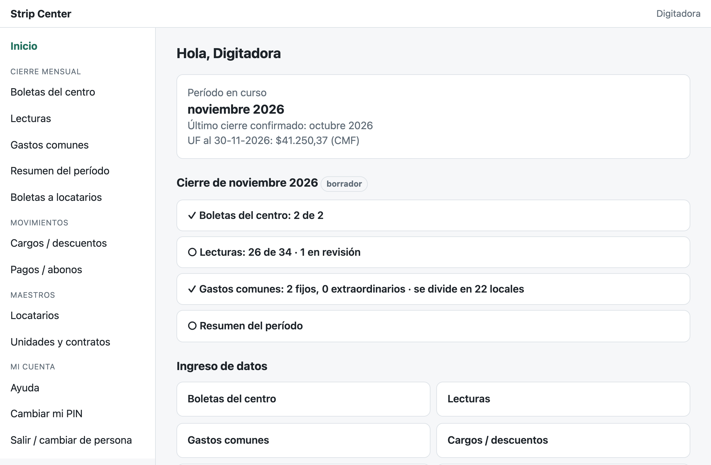
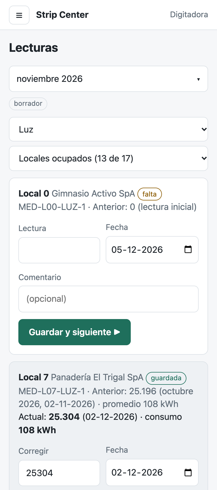
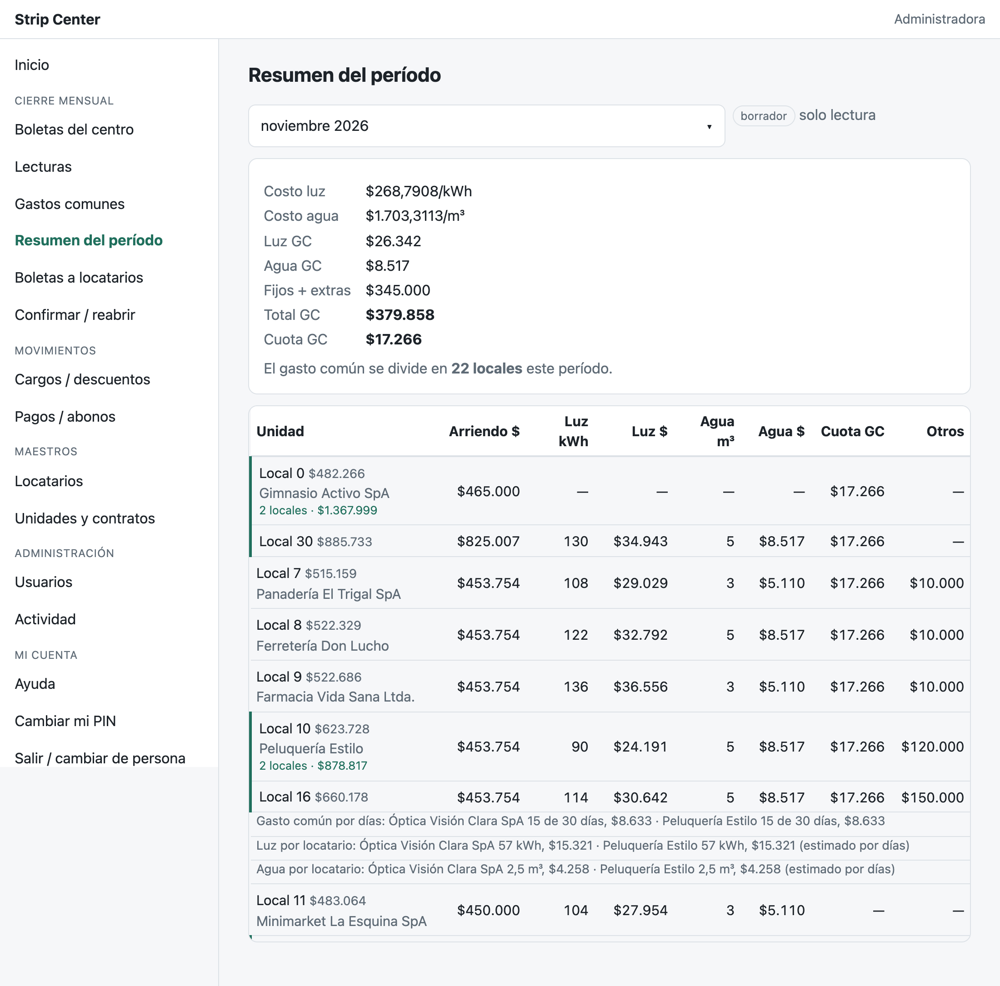
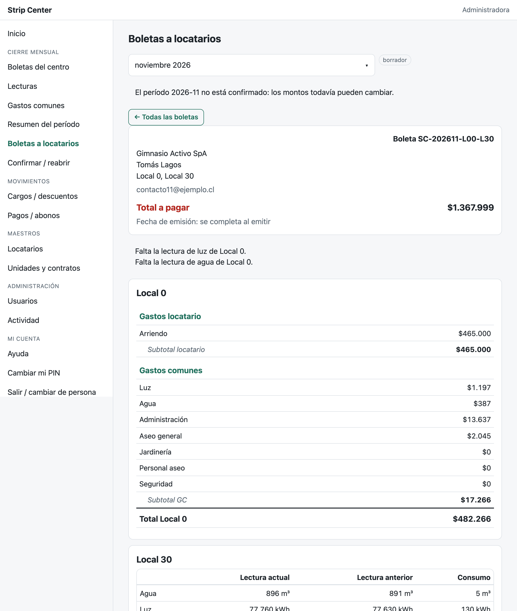

# Strip Center — app de administración y cobranza

Web app en **Google Apps Script** que reemplaza la planilla Excel con la que se administraba un strip center de ~30
locales: lecturas de luz y agua, boletas de servicios del centro, gastos comunes, contratos de arriendo, cargos y pagos,
y el **cierre mensual** que termina en la boleta (estado de cuenta) de cada locatario.

> Proyecto real en uso. Esta es una versión de muestra: nombre genérico, sin datos del cliente ni enlaces a la
> publicación. Las capturas usan datos inventados.

| Inicio (computador) | Lecturas (celular) |
|---|---|
|  |  |

| Resumen del período: consolidado del mes | Vista previa de la boleta por locatario |
|---|---|
|  |  |

## El problema

La planilla funcionaba, pero dependía de una sola persona que conocía sus fórmulas: copiar lecturas a mano, fórmulas
que se rompían (`#REF!`), arriendos que no se prorrateaban, cambios de locatario a mitad de mes resueltos "a ojo" y
acuerdos de palabra que no quedaban escritos en ninguna parte. El objetivo fue pasar el **ingreso de datos** a una
app simple, usable desde el celular, que **valide al ingresar** y deje **trazabilidad** de todo.

## Qué hace

- **Ingreso con roles y PIN**: digitadoras (ingresan), administradora (confirma, corrige, administra usuarios) y
  consulta (solo lectura). Sesión con PIN, bloqueo por intentos y PIN temporal al resetear.
- **Lecturas de medidores** con avisos: lectura menor que la anterior, consumo fuera de lo normal, cambio de medidor,
  lectura en revisión y **traspaso** cuando cambia el locatario a mitad de mes (cada uno paga su parte).
- **Gasto común**: gastos fijos y extraordinarios, luz y agua comunes, divisor configurable y **cobro proporcional a
  los días** de contrato.
- **Contratos**: tramos de arriendo en pesos o **UF** (valor diario desde la API de la CMF), primer y último mes
  proporcional, validación de traslapes, meses de gracia como descuento con motivo.
- **Cargos, descuentos y pagos**, con cuotas.
- **Cierre mensual**: checklist de lo que falta, revisión de bloqueos antes de confirmar, confirmar y reabrir con motivo.
- **Resumen consolidado** y **boleta por locatario** (un locatario con varios locales recibe una sola boleta, con una
  sección por local).
- **Trazabilidad**: nada transaccional se edita; corregir es anular + crear el reemplazo. Cada cambio de un maestro
  queda en `log` con el valor anterior y el nuevo. Revisión diaria de integridad del Sheet con aviso por correo.
- **Ambiente de prueba** separado (otra copia del Sheet y otra publicación), con una franja visible.

## Cómo está armado

```
src/
  Web.js            doGet y enrutador de llamadas desde la página (con control de rol por acción)
  Esquema.js        única fuente de verdad: hojas, columnas y tipos del Sheet
  Setup.js          crea o verifica la carpeta y el Sheet (idempotente: nunca borra)
  Datos.js          lectura y escritura del Sheet, ids, candado
  Calculos.js       reglas de cálculo puras (consumos, prorrateos, gasto común, redondeo, boleta)
  Reglas.js         validaciones (RUT, correo, fechas, traslapes, estado de contratos)
  Cierre.js         lecturas, cierre mensual y resumen del período
  Boleta.js         arma la boleta de cada locatario a partir de todo lo anterior
  Maestros.js, Movimientos.js, Usuarios.js, Pin.js, Sesion.js, Uf.js, Diario.js, Integridad.js, Trazabilidad.js…
  ui/               una sola página (HTML + JS sin frameworks), una vista por pantalla
tests/              pruebas con node:test que cargan el código de Apps Script en un contexto de Node
herramientas/manual página local con un servidor simulado para probar pantallas y sacar capturas
```

- **Base de datos: un Google Sheet**, una hoja por tabla (`unidades`, `medidores`, `locatarios`, `contratos`,
  `contrato_arriendos`, `lecturas`, `boletas_servicio`, `gastos_comunes`, `movimientos`, `pagos`, `cierres`,
  `valores_uf`, `usuarios`, `log`, `catalogos`, `parametros`). El cliente puede seguir mirando y filtrando sus datos
  en un formato conocido.
- **Lógica de negocio separada de Google**: `Calculos.js` y `Reglas.js` son funciones puras, lo que permite probarlas
  en Node sin Apps Script.
- **Sin dependencias**: Apps Script V8 en el servidor y JavaScript simple en el navegador.

## Algunas decisiones de diseño

Durante el proyecto se registraron más de cien decisiones numeradas (los comentarios del código las citan como
`(D117)`); el registro no se publica porque contiene datos del cliente. Algunas representativas:

- **Corregir = anular + reemplazar** en todo lo transaccional: el historial nunca se pierde y siempre se sabe quién
  cambió qué y por qué.
- **El mes se confirma**: después de confirmado, lo emitido no cambia; para corregir hay que reabrir con motivo.
- **Redondeo al peso por línea**, y los subtotales son la suma de las líneas: la boleta siempre cuadra a la vista. En
  el gasto común, el peso que falta se suma al concepto más grande para que el subtotal sea igual a la cuota.
- **UF del último día del mes** guardada en una tabla propia, para que una boleta se pueda reproducir después.
- **Primero en paralelo**: el mes de octubre se calculó con la app y con la planilla, y cada diferencia quedó
  explicada antes de pasar a producción.

## Pruebas

```bash
node --test tests/*.test.js
```

76 pruebas: cálculos de consumo y prorrateo, gasto común proporcional, traspasos, roles por acción, validaciones,
UF, integridad y armado de la boleta.

Para ver las pantallas sin Google, con datos inventados: [herramientas/manual/LEEME.md](herramientas/manual/LEEME.md).

## Instalar una copia propia

1. Crear un proyecto de Apps Script y copiar `.clasp.example.json` como `.clasp.json` con su `scriptId`.
2. `clasp push`, y en el editor ejecutar `configurarBase` (crea la carpeta y el Sheet) y `crearPrimeraAdministradora`
   (el PIN temporal aparece en el registro de ejecución).
3. Propiedad opcional `CMF_API_KEY` para la UF. Publicar como aplicación web y poner su enlace en `URL_APP`
   (`src/Diario.js`), que se usa en los correos automáticos.

## Créditos

Desarrollado por Camila Domínguez, con asistencia de Claude (IA de Anthropic).
